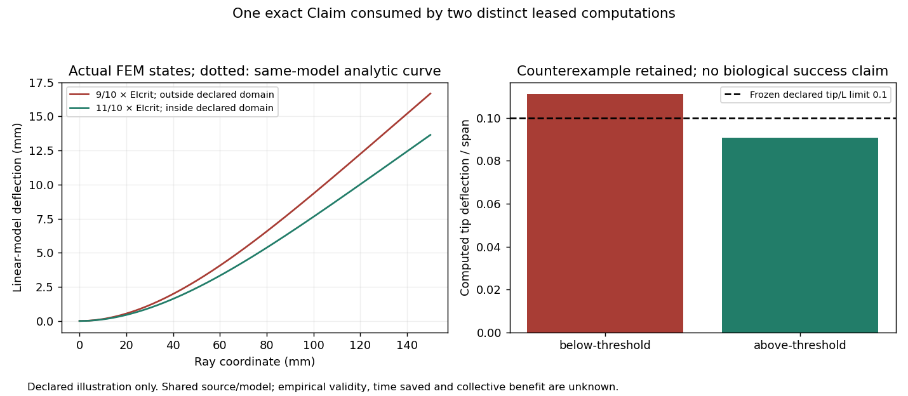

# Actual Claim reuse through two leased computations

One existing exact public Claim was consumed before two distinct bounded
computations, with actual MCP proposals, coordinator readiness, leases, running
states, proposed Evidence and submitted Actions. Independent review is pending;
the producer has not accepted any record. This demonstrates scoped input reuse
and a contribution workflow, not collective benefit or calibrated fish biology.

The shared [Claim read](claim-read.json) pins
`node-a/Claim/eng-finmech-claim-ei-crit@4998ef85bd98ec64c0f4bc86e77337ea25df7ff5683ac6b62dc9095cf5f62f57`.
Its exact rational stiffness threshold is parsed at runtime and multiplied by the
predeclared margin to construct the solver's actual EI input. There is no fallback
hardcoded candidate stiffness. [Protocol](protocol.json) was committed in
`be4dfc6` before candidate solver runs. The current producer result file differs
from the Claim's named source: the [historical result](source-result.json) was
retrieved from the exact source commit and matches its digest; the
[request](source-request.json) matches the original canonical input hash.

| Distinct candidate | Consumed EI (N m²) | Computed tip/span | Maximum slope (rad) | Declared linear-model domain |
|---|---:|---:|---:|---|
| Below threshold, 9/10 × Claim threshold | 11907/20480000 | 0.111111111158 | 0.148148148207 | Invalid; retained counterexample |
| Above threshold, 11/10 × Claim threshold | 14553/20480000 | 0.090909090883 | 0.121212121180 | Inside declared limits |

The declared limits are tip/span≤0.1 and slope≤0.2 rad. Both runs passed the frozen
quadrature, zero-load, wrong-law mutation, FEM/analytic and grid/profile checks.
Maximum FEM tip relative errors were 4.22e-10 and 2.88e-10 against the fixed 1e-6
limit. Static FEM used 16, 32 and 64 elements; there is no time step. Actual
compute/control wall times were approximately 0.486 and 0.459 seconds, excluding
MCP transport and preparation. No cloud or GPU job was used.

The existing load bridge and beam solver were reused. All pressure, geometry,
material and validity inputs remain declared illustration assumptions. The
invalid lower candidate is not a biological deformation prediction. Empirical
validation and biological success remain unknown; no success probability,
time/cost saving or agency advantage is assigned.

## Inspectable evidence

- [Audit](audit.json) verifies exact Record digests, producer links, artifact
  bytes, code/protocol pins and chronological Claim-read→input-binding→solver→
  Evidence ordering. It counts two distinct current Action **ids**, not merely
  repeated versions. Its chronology uses producer-witnessed UTC, not an external
  time anchor.
- [Typed uses edges](reuse-verification.json) were read back from the live MCP
  neighborhood; the graph was not truncated. [Public catalog readback](public-catalog-readback.json)
  independently returns both current Action heads as submitted.
- Per-case [lower result](below-threshold/result.json) and
  [higher result](above-threshold/result.json), effective inputs, actual profile
  CSVs, exact pre-run Claim reads, proposed Evidence receipts and submitted Action
  readbacks retain the numerical and workflow details.
- [Execution plan](execution-plan.json), [code pins](code-pin.json),
  [environment](environment.json) and safe MCP transcripts preserve provenance.
  Credentials and lease capabilities are excluded/redacted.
- [Superseded proposals](superseded-proposals.json) preserve one correction made
  **before any lease or computation**: initial ready versions were replaced to
  strengthen protocol/numerics/code cache identity. Scientific inputs and criteria
  were unchanged. Those original versions had no lease and are non-executable
  non-heads; they are excluded from the executed reuse count. Root's original
  coordinator-readiness receipt was not altered.
- [Plot provenance](report-provenance.json) is separate from solver production.
  The figure was rendered from actual saved CSV states. Artifact declarations use
  reference-only content URNs and unknown licenses remain null; public hosting and
  byte-availability projection are separate from scientific acceptance.

The worker used only contributor authority. Readiness came from the coordinator;
review requires a separate operator. At captured producer readback both Actions
were **submitted** and both Evidence records **proposed**. A subsequent reviewer
receipt may update those states without changing these historical receipts.

## Bounded independent replay

Use an isolated checkout and separate output directory. Under a 1-CPU, 4-GiB,
swap-zero, 128-task, 600-second systemd scope with numeric-library threads set to
one, load the frozen protocol and each saved pre-run Claim record, then call
`engineering.claim_reuse.compute.compute(record, protocol, case, review_output)`.
This needs NumPy/SciPy and the existing source tree, not the producer credential.
Check original artifact hashes first; compare physical profiles/metrics under the
already frozen tolerances. Timestamps/wall time make whole-result JSON byte
identity inappropriate. Running the contribution client again is deliberately
blocked by its existing-attempt guard; replay is distinct from another live lease.

Six focused input-integrity, causal-binding, redaction and cache-identity tests
passed before execution. The final audit independently checked actual persisted
records and artifacts. Neither result establishes biological validity.
