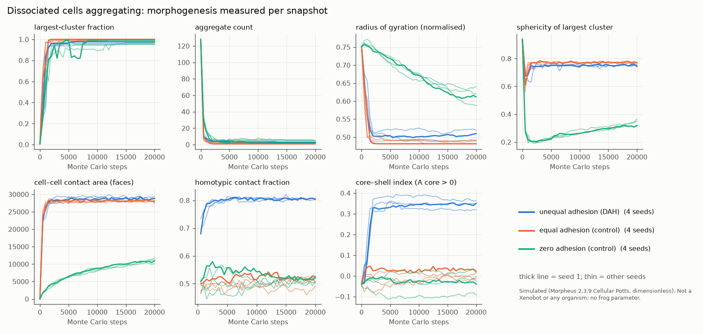
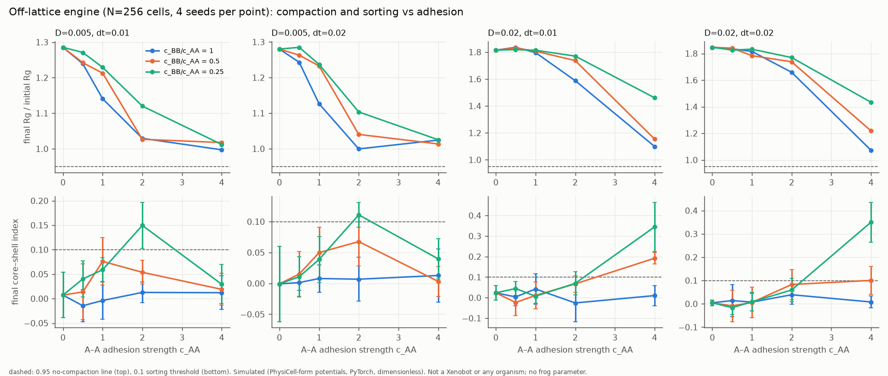
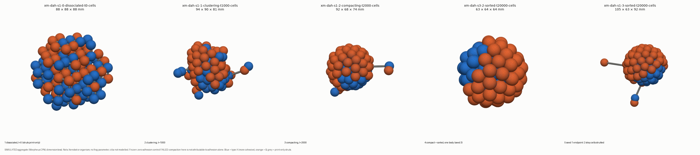

# Xenomorph: dissociated cells aggregating into a compact body, and a printable model made of cells

Written 2026-11-01 (Seattle, PST). Branch `claude/xenomorph-20261101`.

> **What this is.** A *simulated aggregate morphology*: generic cells with differential adhesion, in a Cellular Potts
> model (Morpheus 2.3.9), cross-checked by an off-lattice engine. **It is not a Xenobot and not any organism.**
> **No frog parameter is used.** Every energy, temperature and size is dimensionless (lattice units, Monte Carlo
> steps). The published constructs (Kriegman 2020 PNAS; Blackiston 2021 Sci Robot, both read at abstract level only)
> **move by cilia. Cilia are not modelled here, and neither is contraction**; contraction is this project's own
> modelling choice elsewhere and is absent from this simulation. A printed object is **a physical model of a
> simulation**: not a living construct, not a biological validation, and it demonstrates nothing about viability.

## Results (read this first)

**Headline: the frozen zero-adhesion control FAILED, so the frozen Cellular Potts aggregation result is not readable.**
The protocol said a zero-adhesion failure means "no other arm may be read", and that is what we report.

What did hold:
- three independent engines agree that a *sparse* dissociated suspension does not compact by adhesion alone;
- the print pipeline produced 14 verified, cell-resolved STLs;
- the Morpheus runs are bit-reproducible across machines.

### Morpheus CPM, frozen arms (16 runs, all exit 0; Nebius L40S-node job `aijob-e00vzbhpapp9q8hrmr`, 40 vCPU)

| gate (frozen) | result | numbers (final vs t = 0, seeds 1–4) |
|---|---|---|
| zero-adhesion: no compaction (Rg ratio ≥ 0.95) | **FAIL** | Rg ratio 0.815, 0.853, 0.781, 0.823 |
| equal-adhesion: no sorting | pass (not readable) | mean core–shell +0.005, homotypic 0.506 |
| dah compaction (largest ≥ 0.9, Rg −20 %) | pass (not readable) | largest 0.98/0.99/1.00/0.96; Rg −32/−35/−36/−31 % |
| equal compaction | pass (not readable) | Rg −36/−35/−36/−35 % |
| dah sorting (core–shell > 0.1, homotypic margin) | pass (not readable) | core–shell +0.35/+0.32/+0.35/+0.36; homotypic 0.80 vs 0.51 |



**What the curves show (descriptive, not a claim).**
- **The adhesive arms** collapse within about 1500 MCS to the volume of a ball (rg_norm 0.48–0.52; a perfect ball is 0.481).
- **dah** reaches a stable A-core / B-shell. Post-hoc: A cells expose only 3–5 % of their surface to medium, against 14–15 % in `equal`.
- **The zero arm** creeps instead. Rg falls roughly linearly to 0.59–0.64, and cell–cell contact grows slowly to about 40 % of the adhesive level, as a loose network (sphericity of the largest cluster about 0.3).

**Diagnosis (addendum 2, declared before running; `results/xenomorph/diagnosis_addendum2.json`).**
- *Fragmentation is not the cause.* With `ConnectivityConstraint`, cells no longer fragment (0 of 128 against 124–128 without), and zero still compacts (0.83, 0.79).
- *Neutral contact is not neutral here.* Raising every cell–cell J by +2 or +6 turns zero-arm compaction into expansion (Rg ×1.42–1.51). With Morpheus's order-2 / distance-2.5 neighbourhood, J_cc = 2·J_cM acts as a weak effective adhesion, smaller than +2 J units per face pair. The designed arms have γ = 6–9.
- *Nearest-neighbour lattice.* In order 1 the lattice is kinetically frozen: no arm aggregates (120–128 aggregates after 20 000 MCS). So zero-n1 "passes" trivially. The declared post-diagnosis arm dah-n1 **fails** compaction.
- *Conclusion.* The CPM result stays unreadable. Next step (not run): a new protocol that calibrates the empirically neutral offset first, then tests dah and equal against it.

**Refinement (dah, seeds 1–2, s = 0.75 / 1.0 / 1.25, J/T/λ fixed, horizon ∝ s²).**
- Resolution-stable by the frozen rule: largest-cluster fraction, sphericity and Rg.
- **Not** resolution-stable: the homotypic index (falls about 0.01–0.015 per step) and core–shell (seed 1: 0.35 → 0.28).
- No claim depends on their exact values.
- An erratum to the rule's "1.0 vs 1.5" wording is in addendum 1.

**Reproducibility.** dah seed 1 was re-run on sb02. All 41 of 41 snapshot TIFFs are byte-identical to the Nebius run (`results/xenomorph/reproducibility_dah_s1.json`), so seed spread is pure seed-to-seed variation.

**Artifact found and kept visible.** Without a connectivity constraint, almost every CPM cell ends up split into pieces. About 6 % of a cell's voxels sit outside its main body (pilot), so cell centroids used by the print are slightly biased.

### Second and third engines: sparse starts never compact

- **Off-lattice GPU engine** (`offlattice.py`, PhysiCell-1.x potential form, NVIDIA L40S, 865 s, GPU utilisation 97 % while busy).
  - 208 systems of 256 cells at 11.6 % volume fraction, swept over c_AA × c_BB/c_AA × D × dt × 4 seeds.
  - Zero adhesion: no compaction (Rg ×1.29), so the control passes.
  - Clustering: with adhesion, the cluster count falls from 256 to about 27, but **no setting compacts** (Rg ratio ≥ 0.997, largest cluster ≤ 0.21).
  - Strong adhesion arrests clusters without sorting.
  - Moderate adhesion with c_BB/c_AA = 0.25 sorts locally (homotypic 0.78).
  - dt 0.02 → 0.01 changes are inside the seed range.
  - An N = 1024 arm behaves the same: Rg ratio ≥ 0.9985, largest cluster ≤ 0.08.
  - 
- **PhysiCell 1.14.2** (`physicell_check.py`; 250 default-size cells, 15 % volume fraction, random motility).
  - zero and equal controls pass.
  - dah **fails** compaction in both seeds (10–16 clusters plateau).
  - dah sorts *within* clusters (largest-cluster core–shell 0.69–0.73).
  - Adhesion strengths were raised from the template's values, with a force-balance reason recorded *before* the runs.
- **Morpheus low-density pilot.** The same stall (about 21 non-merging clusters).

**Cross-engine reading.** In all three engines, a sparse dissociated suspension with adhesion forms clusters that stop merging. Whole clusters barely move, so global compaction needs a dense start or a gathering mechanism. Examples are gravity in a well, or stronger, persistent motility. None of those is modelled. Compaction from a dense start occurs in the CPM, but that result is not readable because of the failed control.

### The printable set (`artifacts/xenomorph-print/`)



| object | file (cells) | size (mm) | volume / mass @1.18 g/cm³ | pieces without struts | struts |
|---|---|---|---|---|---|
| 1 dissociated, t = 0 | `dah-s1/stl/xm-dah-s1-0-dissociated-t0-cells.stl` | 88 × 88 × 88 | 115.8 cm³ / 137 g | 128 (needs radius ×1.31) | 127 |
| 2 clustering, t = 1000 | `dah-s1/stl/xm-dah-s1-1-clustering-t1000-cells.stl` | 94 × 90 × 81 | 95.7 cm³ / 113 g | 7 | 6 |
| 3 compacting, t = 2000 | `dah-s1/stl/xm-dah-s1-2-compacting-t2000-cells.stl` | 92 × 68 × 74 | 96.9 cm³ / 114 g | 4 | 3 |
| 4 compact + sorted, one body | `dah-s3/stl/xm-dah-s3-2-sorted-t20000-cells.stl` | 63 × 64 × 64 | 97.5 cm³ / 115 g | **1** | 0 |
| 5 seed-1 endpoint | `dah-s1/stl/xm-dah-s1-3-sorted-t20000-cells.stl` | 105 × 63 × 92 | 98.0 cm³ / 116 g | 3 (2 stray cells) | 2 |

- **All 14 STLs pass every check** (cells and surface versions). Each is a closed, consistently oriented 2-manifold (also after an STL re-read), one body, with 0 degenerate triangles, and fits a 120 mm box.
- **Walls:** the sampled minimum is 2.45 mm, set by the struts, against the 1.0 mm rule. The compact body's minimum is 11.7 mm. The thinnest accepted cell-to-cell neck is ≥ 2.5 mm.
- **Records:** hashes, check reports and the scale block are in each `manifest.json`.
- **Selection:**
  - The stage rule (in `printable.choose_stages`) was declared before the production fields were read.
  - Seed 1 is the primary series, as named in addendum 1. Seed 3 is added because it ends as one 128-cell body.
  - The rule found no separate "compact" stage in either seed (it merged with the final snapshot), so the set has 5 objects from the two series.
- **Printer and resin are unknown.** Nothing has been sliced or printed.
- **These are prints of a simulation whose own control failed.** They show what the model produced. They do not show that adhesion caused it.

### Review (gemini-4-argon), and what changed
Full text: `docs/xenomorph/argon_review_2026-11-01.md`.

| item | response |
|---|---|
| 1 refinement keeps J/T/λ fixed | Kept as frozen. Recorded as a limitation in addendum 1. |
| 2 "spheres become a ball-and-stick truss" | Rejected on measurement. Compact states are one body with 0 struts and necks ≥ 2.5 mm. |
| 3 face-based vs order-2 contacts | Added the post-hoc 26-neighbourhood aggregate count. |
| 4 verdict-rule typo (1.5 vs 1.25) | Erratum in addendum 1. |
| 5 core–shell about the global centroid | Added post-hoc core–shell on the largest cluster and A/B medium exposure. |
| 6 zero-arm definition | Kept the standard γ = 0 definition. The run then showed it is not neutral on this lattice (see diagnosis). |
| 7 `k_needed` ignored the neck rule | Fixed, with a test. |
| 8 fragmentation | Measured. Added the ConnectivityConstraint arms. |

### Compute receipts

All parts were returned through job logs, base64-encoded and sha256-checked.
- **Nebius (Nebius CPU quota was exhausted, so the CPU work ran on GPU-preset nodes):**
  - `aijob-e00vzbhpapp9q8hrmr` (16 arms + GPU sweep, 26 min);
  - `aijob-e00q043k9pv5c96g5j` (6 connectivity arms + N = 1024 GPU arm);
  - `aijob-e00z0r6npj1x0h6nxn` (10 diagnostic arms).
- **Not used:** GCP VM03 (ssh exit 255).
- **Log transport.** `ai job logs` caps output at 1000 lines and 1-second timestamps. `dump_log.py` pages `nebius logging query --forward` instead. Two parts first failed sha256 because nanosecond timestamps with trimmed zeros were string-sorted. They were fixed by sorting on parsed nanoseconds.


## Model

**Cellular Potts (Morpheus 2.3.9, binary sha256 `3d9a6e5a…5d94`, source tag v2.3.9 = `29a26b0`).** Each cell is a set of
lattice voxels with id σ. The engine minimises, by Metropolis copy attempts at temperature T,

  H = Σ_(neighbour pairs i,j; σi≠σj) J(τ(σi), τ(σj)) + Σ_cells λ_V (V_σ − V_target)²

on a 100³ cubic lattice, neighbourhood order 2, no-flux boundaries, T = 3, λ_V = 1, V_target = 257 voxels (a radius-4
sphere). Template: Morpheus's own `Examples/CPM/CellSorting_3D.xml` (Graner & Glazier 1992), re-parameterised.

**Differential adhesion.** With surface tensions γ_xM = J_xM − J_xx/2 and γ_AB = J_AB − (J_AA + J_BB)/2
(Glazier & Graner 1993), a population compacts when every γ_xM > 0, and type B engulfs type A when
γ_AM > γ_AB + γ_BM.

| arm | J_AA | J_BB | J_AB | J_AM = J_BM | γ_AM | γ_BM | γ_AB | expectation |
|---|---|---|---|---|---|---|---|---|
| `dah` (main) | 2 | 8 | 7 | 10 | 9 | 6 | 2 | compact; 9 > 2 + 6 so B engulfs A (A core, B shell) |
| `equal` (control) | 4 | 4 | 4 | 10 | 8 | 8 | 0 | compact, must **not** sort |
| `zero` (control) | 20 | 20 | 20 | 10 | 0 | 0 | 0 | contact carries no energy: must **not** compact |

**Dissociated start.** 128 cells (64 A, 64 B by seeded shuffle) on the 128 sites of a simple-cubic lattice nearest
the centre, spacing 2r + gap + 2·jitter = 10 voxels, each jittered ±0.5 per axis, so no two cells touch at t = 0
(checked in every run: 128 aggregates at t = 0). Horizon 20 000 MCS, snapshots every 500.

**Off-lattice engine (second engine, GPU).** `engineering/xenomorph/offlattice.py`, PyTorch, overdamped, PhysiCell-1.x
potential form: repulsion c_r(1 − d/2r)² for d < 2r, adhesion −c_ij(1 − d/R_A)² for d < R_A = 2.5 r, plus Brownian
noise √(2 D dt) ξ. r = 1, c_r = 10, 256 cells, start with no pair inside adhesion range. Swept c_AA ∈ {0, 0.5, 1, 2, 4},
c_BB/c_AA ∈ {1, 0.5, 0.25}, c_AB = √(c_AA c_BB), D ∈ {0.005, 0.02}, dt ∈ {0.02, 0.01}, 4 seeds: 208 systems in one
batched GPU run. This is **not PhysiCell**; it reimplements its published potential form. A PhysiCell 1.14.2
run of the three arms is reported separately below.

## Protocol, frozen before production

`engineering/xenomorph/protocol.json` sha256 `b4e329ba…3e4f` (commit `f6a67d98`), then
`protocol_addendum_1.json` (own sha256 in `protocol_addendum_1.sha256`, commit `e671f14e`) written while the
production job ran and before any of its results were read. The addendum's text says "~09:05 PST"; the
commit was actually made at about 08:50 PST. Addendum 2 (diagnosis, own sha256) was written after the frozen results were read, and says so. Two pilots ran before the freeze (seeds 98, 99; `results/xenomorph/pilot/`):
- a low-density start stalled in ~21 clusters that never merged;
- the dense start compacts.

The zero-adhesion gate was set on Rg because jammed cells touch without cohesion.

Measurements per snapshot (`analyze.py`): aggregate count (contact-graph components, face adjacency), largest-cluster
fraction, sphericity of the largest cluster (marching-cubes area), cell–cell and cell–medium contact area (voxel
faces), radius of gyration (normalised by (N·V)^(1/3)), homotypic contact fraction (sorting index), core–shell index.

## Printable model

`engineering/xenomorph/printable.py`, built on the repo's print stack (`engineering/geometry/validate.py`
for every check, manifold3d 3.5.4 for every boolean and for ray-cast wall sampling), following `docs/printing.md`.

- **Units and scale.** The simulation is dimensionless. A nominal voxel length **h = 20 µm** is *declared*, not
  measured. It makes the compact aggregate about 0.8 mm across, the order the brief gives. It is not a frog cell
  size. The display scale is **75**, so `prop_mm = biological_m × 1000 × 75`: 1 voxel = 1.5 mm and the compact
  aggregate is about 63 mm.
- **Cell-resolved solid (`*-cells.stl`).** Every cell is a sphere of its equal-volume radius at its voxel centroid.
  The spheres are unioned, so the print is visibly made of cells. Two cells count as joined only if their spheres
  intersect in a neck of radius ≥ 1.25 mm.
  - If a snapshot is not one body (dissociated and clustering stages), the report states the piece count and the
    radius factor that would join it.
  - It then adds **print-only connector struts**: r = 1.25 mm, fixed, never scaled from biology, grey in the renders.
    They run along a minimum spanning tree between pieces.
  - Sealed internal cavities are filled so they cannot trap resin.
- **Surface solid (`*-surface.stl`).** Marching cubes (level 0.5) on the occupancy field after Gaussian smoothing
  (σ = 1 voxel).
- **Checks on every STL.**
  - Closed, consistently oriented 2-manifold, recomputed from the triangle arrays and again after an STL round trip.
  - One face-connected body.
  - Fits a 120 mm box.
  - Wall ≥ 1.0 mm on 3 000 ray-cast samples (the repo's provisional rule).
  - Volume, and mass at an *assumed* 1.18 g/cm³.
  - A sha256 per file.
- **Not checked.** Self-intersection (manifold3d booleans produce none by construction), slicing, supports, cups,
  resin-specific limits. **Printer and resin are unknown.** Run the `docs/printing.md` operator checklist in PreForm
  before printing.

## Reproduce

```
uv venv --python 3.13 .venv-xm && VIRTUAL_ENV=.venv-xm uv pip install numpy==2.4.4 scipy scikit-image tifffile trimesh==5.2.0 manifold3d==3.5.4 matplotlib==3.11.2 imageio
python -m engineering.xenomorph.cpm_model --arm dah --seed 1 --out RUN      # needs the Morpheus 2.3.9 binary (MORPHEUS_BIN)
python -m engineering.xenomorph.analyze RUN && python -m engineering.xenomorph.pack_fields RUN
python -m engineering.xenomorph.printable --fields RUN/fields.npz --metrics RUN/metrics.json --out OUT
python -m pytest --noconftest tests/test_xenomorph.py
```
